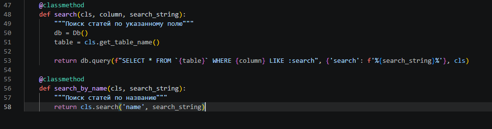
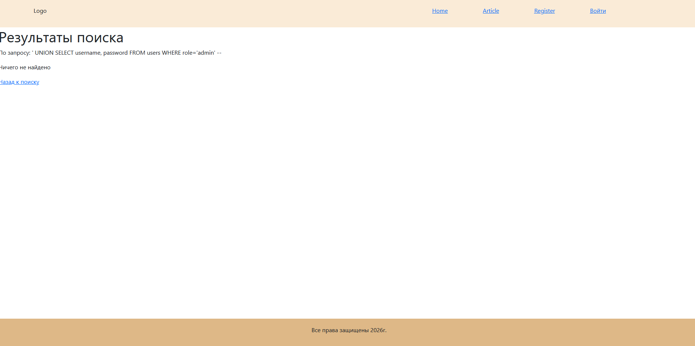

# Конспект: лабораторная 4.2 — анализ SQL-уязвимости

**Цель:** найти SQL-уязвимость на своём сайте, показать место защиты от инъекций в коде, дать рекомендации.

## 1. Анализ кода

```python
@classmethod
def search(cls, column, search_string):
    """Поиск статей по указанному полю"""
    db = Db()
    table = cls.get_table_name()
    return db.query(f"SELECT * FROM `{table}` WHERE {column} LIKE :search",
                    {'search': f'%{search_string}%'}, cls)

@classmethod
def search_by_name(cls, search_string):
    """Поиск статей по названию"""
    return cls.search('name', search_string)
```





- `search_string` передаётся **отдельным параметром** (`:search` + словарь) — классическая SQL-инъекция исключена.
- `{table}` и `{column}` подставляются через **f-строку**, мимо параметризации. Если они когда-нибудь будут формироваться из пользовательского ввода — риск **identifier injection**.
- Сейчас `column` — литерал `'name'`, `table` — из `cls.get_table_name()`: источники доверенные, уязвимости нет.

## 2. Где реализована защита

Строка `db.query(f"... LIKE :search", {'search': ...}, cls)`.

| Механизм | Где | Что защищает |
|----------|-----|--------------|
| Параметризация (`:search` + словарь) | 2-й аргумент `db.query(...)` | значение `search_string` |
| Подстановка через `LIKE :search` | тело SQL-запроса | поисковая строка |
| Доверенный источник имени таблицы | `cls.get_table_name()` | `{table}` |
| Литерал для имени колонки | `cls.search('name', ...)` | `{column}` |

## 3. Рекомендации

1. Значения от пользователя — только через плейсхолдеры (`:param`, `%s`, `?`).
2. Имена таблиц/колонок не брать из ввода; если нужна динамика — **whitelist**:
   ```python
   ALLOWED_COLUMNS = {'name', 'content', 'created_at'}
   if column not in ALLOWED_COLUMNS:
       raise ValueError("Недопустимое поле поиска")
   ```
3. Экранировать идентификаторы средствами драйвера (PostgreSQL: `psycopg2.sql.Identifier`; MySQL: обратные кавычки + whitelist).
4. Использовать ORM (SQLAlchemy, Django ORM).
5. Принцип наименьших привилегий для учётки БД (без `DROP`, `ALTER`, `GRANT`).
6. Валидировать ввод по типу, длине, допустимым символам.
7. Дополнительно: логирование подозрительных запросов, WAF, SAST (Bandit, Semgrep, SonarQube).

## Выводы

1. Защита значения `search_string` реализована корректно (параметризованный запрос).
2. Остаточный риск — интерполяция имён таблицы и колонки; сейчас не эксплуатируем (доверенные источники).
3. Для полной безопасности: whitelist идентификаторов, экранирование драйвером или ORM, наименьшие привилегии.
4. Минимум защиты = параметризация значений + whitelist идентификаторов + ORM.
