# Конспект: лабораторная 4.3 — XSS-инъекции

## Часть 1. Задания на учебном стенде (скриншоты)

### 1. XSS Reflected (LOW)

Вредоносный скрипт передаётся в адресной строке и сразу отражается в ответе: `<script>alert("Reflected XSS")</script>`


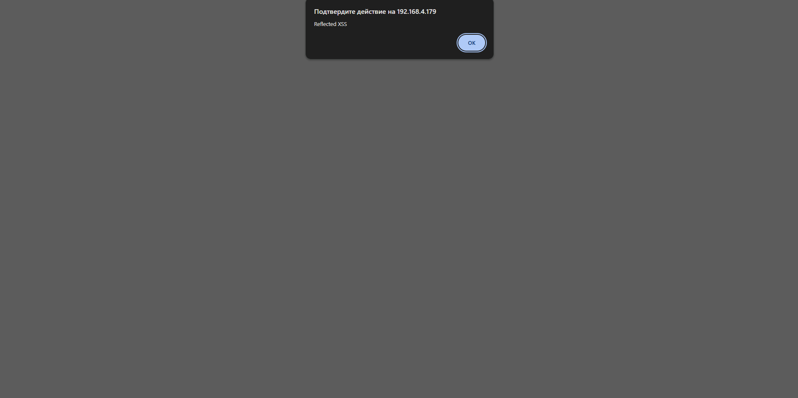

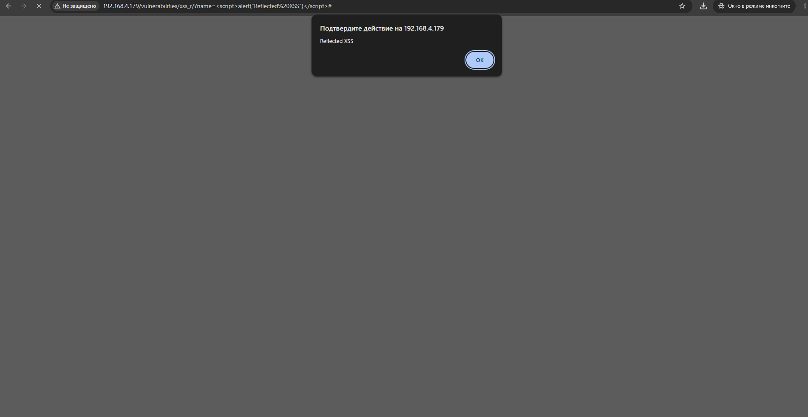

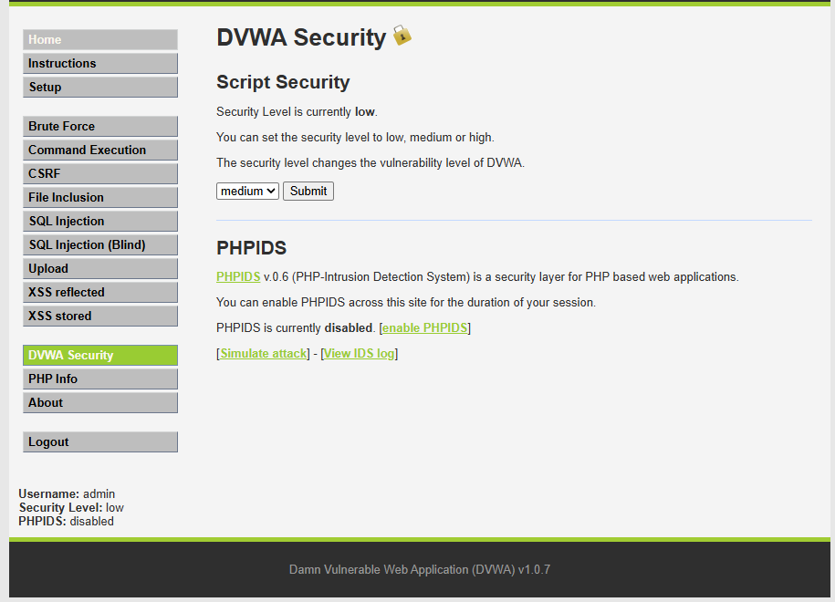

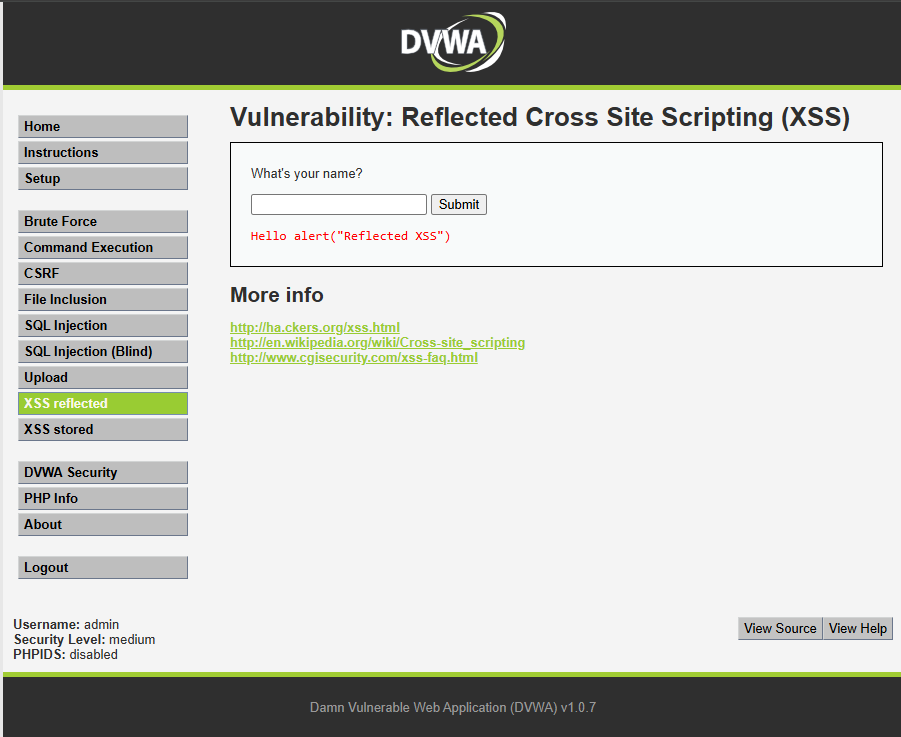

### 2. XSS Stored

Скрипт сохраняется на сервере и выполняется у каждого, кто открывает страницу.

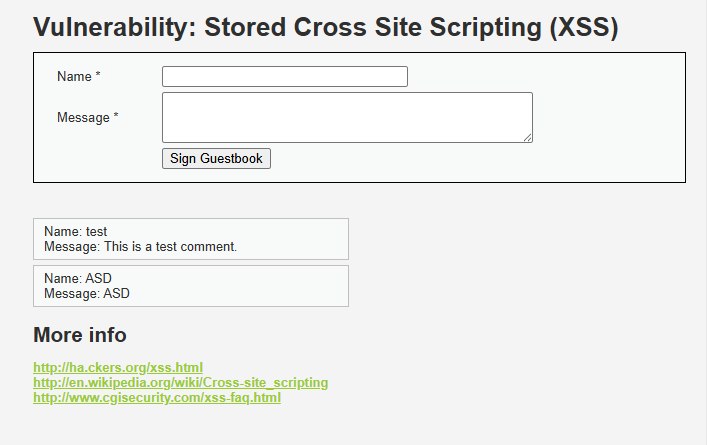

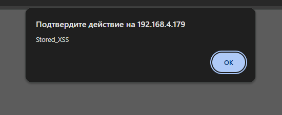

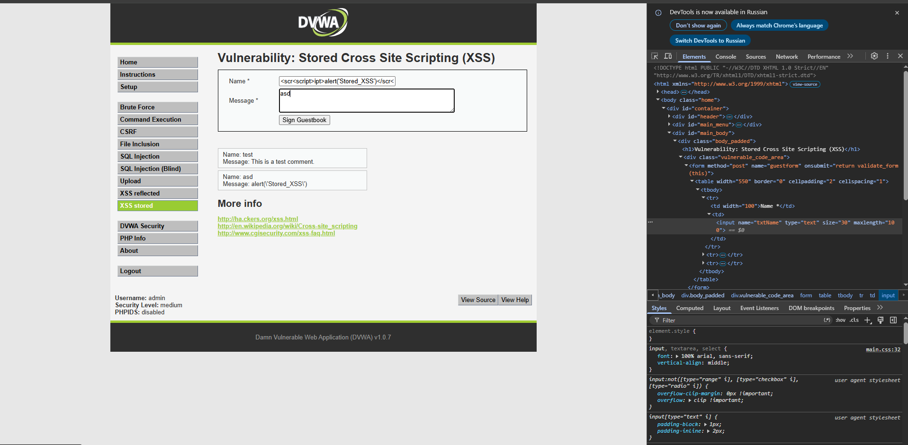

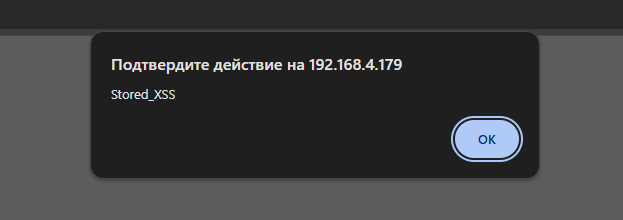

### 3. XSS DOM

Скрипт выполняется из-за небезопасной обработки данных в клиентском JS.

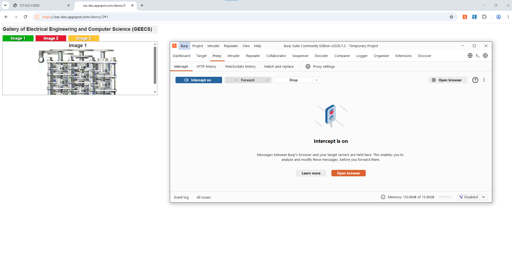

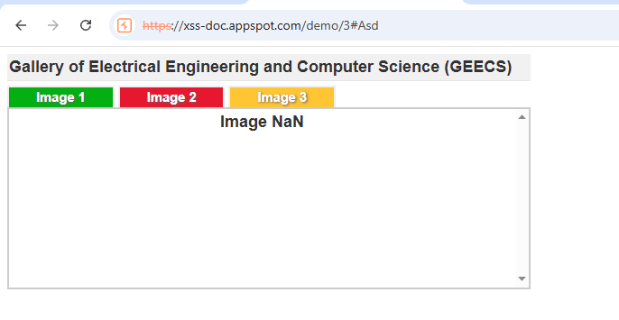

### 4. Свой сайт / сайт одногруппника

Проверка на XSS, использован вектор: `<body onload=alert('XSS')>`

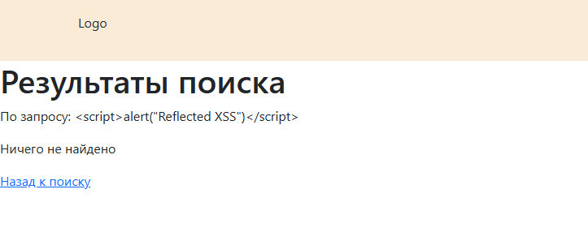

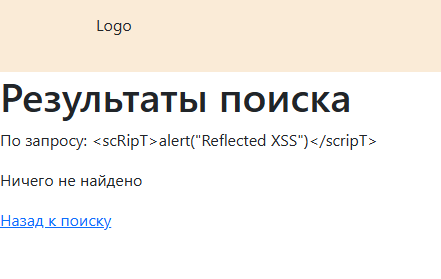

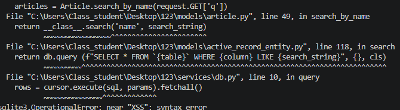


## Часть 2. Аудит собственного сайта (Flask + Jinja2, http://127.0.0.1:5000)

**Цель:** проверить сайт на Reflected, Stored и DOM-based XSS, дать рекомендации, при необходимости исправить код.

### Точки ввода

| № | Функция | Поля | Метод |
|---|---------|------|-------|
| 1 | Поиск | `q` | GET |
| 2 | Регистрация | логин, email, пароль | POST |
| 3 | Логин | логин, пароль | POST |
| 4 | Редактирование статьи | название, текст, URL картинки | POST |
| 5 | Просмотр статьи | данные из БД | GET |

### Тестирование

- **Reflected (поиск).** Векторы: `<script>alert(1)</script>`, `">`, `<svg/onload=alert(1)>`. Скрипт не выполнился; в HTML спецсимволы экранированы (`&lt;script&gt;...`). **Не работает.**
- **SSTI (побочный тест).** `{{ article.get_text() | safe }}` выводится как текст, Jinja2 вложенные шаблоны не рендерит. **Не работает.**
- **Stored.** Статья с `<script>alert(document.cookie)</script>` в названии и тексте отображается как текст благодаря автоэкранированию. **Не работает.**
- **DOM-based.** Поиск опасных паттернов в JS:
  `grep -rn "innerHTML\|document.write\|eval(\|location.hash\|document.URL" static/` — пусто. **Не обнаружен.**
- **Конфигурация шаблонизатора.** `grep -rn "|safe" templates/` и `grep -rn "autoescape false" templates/` — пусто. Защита включена:

```python
env = Environment(
    loader=FileSystemLoader('templates'),
    autoescape=select_autoescape(['html', 'xml'])
)
```

### Сводная таблица

| Функция                    | Тип XSS   | Результат     |
| -------------------------- | --------- | ------------- |
| Поиск                      | Reflected | ❌ не работает |
| Просмотр / создание статьи | Stored    | ❌ не работает |
| Регистрация / логин        | Reflected | ❌ не работает |
| JavaScript                 | DOM-based | ❌ не работает |

### Рекомендации

1. Экранирование вывода (уже есть: `autoescape` + `{{ }}` без `|safe`).
2. Валидация и санитизация ввода; для статей с HTML — `bleach`/html-sanitizer вместо `|safe`.
3. CSP: `Content-Security-Policy: default-src 'self'; script-src 'self'`.
4. Флаги cookie: `HttpOnly`, `Secure`, `SameSite=Lax`.
5. Заголовки: `X-Content-Type-Options: nosniff`, `X-Frame-Options: DENY`.
6. Регулярный аудит: `grep -rn "|safe\|Markup(\|autoescape false"`, статический анализ `bandit`.

### Исправления

Сайт изначально защищён, исправления не требовались. Дополнительно внедрена защита по принципу defense in depth:

```python
app.config['SESSION_COOKIE_HTTPONLY'] = True
app.config['SESSION_COOKIE_SAMESITE'] = 'Lax'

@app.after_request
def add_security_headers(response):
    response.headers['Content-Security-Policy'] = (
        "default-src 'self'; script-src 'self'; "
        "style-src 'self' 'unsafe-inline'; img-src 'self' data:;"
    )
    response.headers['X-Content-Type-Options'] = 'nosniff'
    response.headers['X-Frame-Options'] = 'DENY'
    return response
```

## Выводы

- Сайт защищён от всех трёх типов XSS.
- Главный механизм — автоэкранирование Jinja2 + `{{ }}` без `|safe`.
- grep-аудит подтвердил отсутствие `|safe` и отключённого autoescape; в JS нет `innerHTML`, `eval`, `document.write`.
- Добавлены cookie-флаги, CSP, security-заголовки, ограничение длины поискового запроса.
- **Ключевой урок:** большинство XSS возникает из-за небрежности (отключённый autoescape, `|safe` для произвольных данных, склейка строк в HTML), а не из-за сложных атак.
