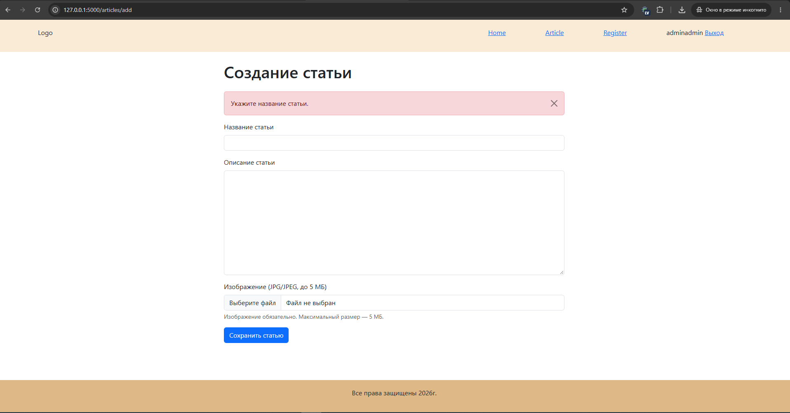
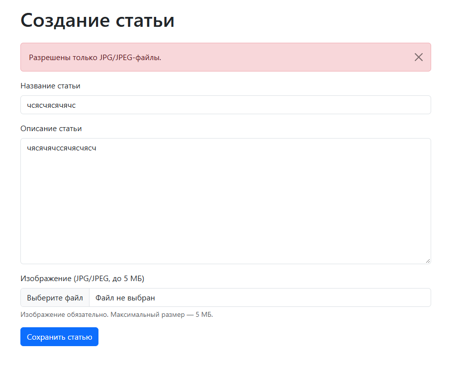
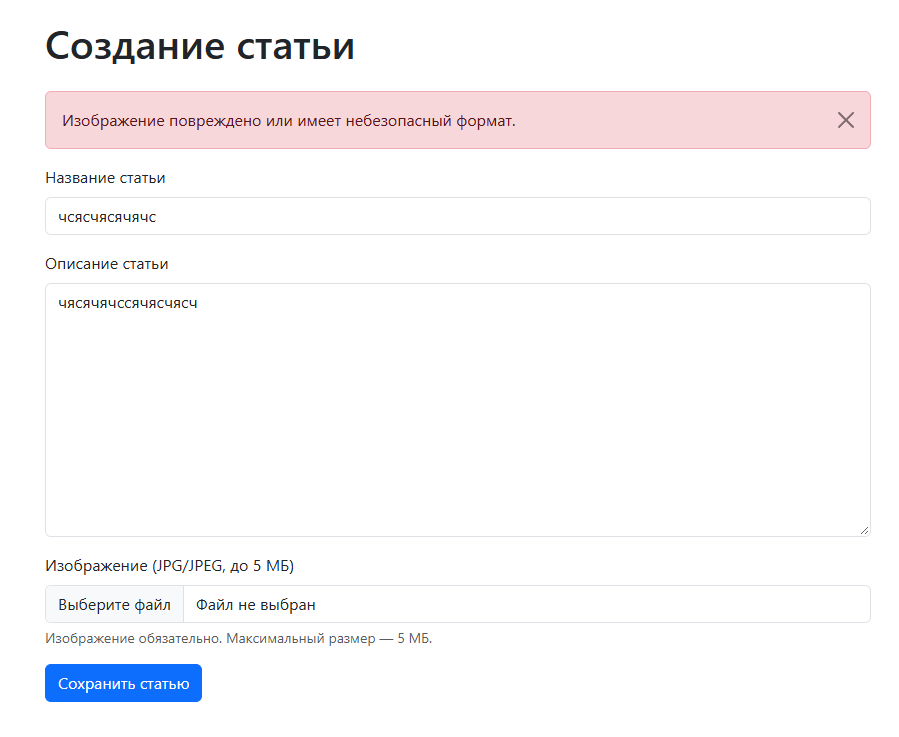
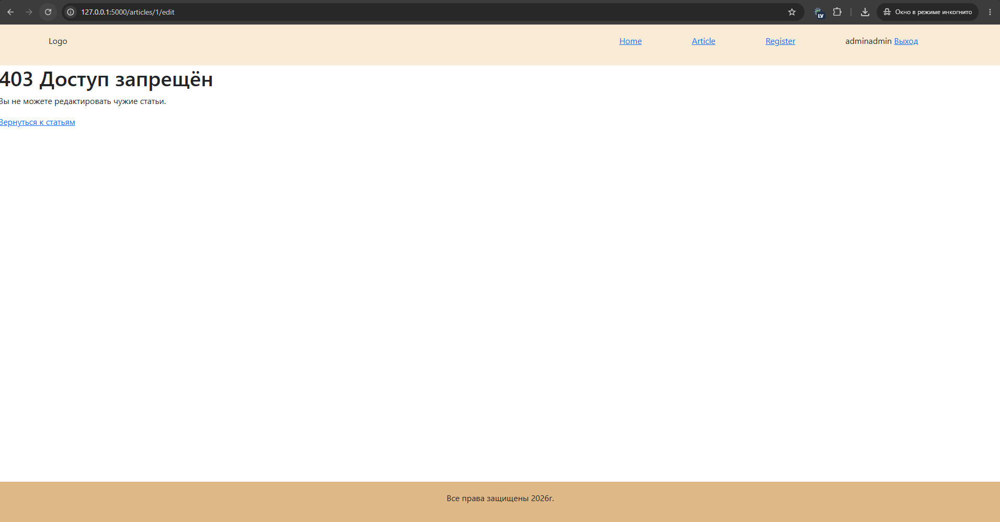
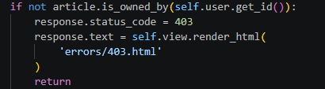

# Конспект: практическая 6 — Unrestricted File Upload

**Тема:** исследование Unrestricted File Upload и защита загрузки изображений.

## Цель и задачи

Изучить уязвимость в bWAPP и DVWA (разные уровни защиты) и защитить загрузку изображений в своём приложении `krehovets.loc-main` на маршруте `POST /articles/add`.

Задачи:
- найти страницы и маршруты загрузки файлов;
- проверить bWAPP на Low и Medium;
- проверить DVWA на Low и Medium, сравнить с High;
- реализовать серверную проверку загрузки изображения;
- запретить создание статьи без названия, описания и изображения;
- показывать ошибки на `/articles/add` без редиректа, чтобы можно было исправить и отправить повторно.

## Теория

**Unrestricted File Upload** — приложение принимает файлы без достаточной проверки расширения, реального содержимого, размера, имени и места хранения. Проверки по расширению или MIME-типу от браузера **недостаточно** — их можно подменить.

Последствия: сохранение непредусмотренных файлов, перезапись файлов, опасное содержимое, отказ в обслуживании.

**Защита (на сервере):**
- разрешать только нужные форматы;
- проверять реальное содержимое;
- ограничивать размер и разрешение;
- генерировать безопасное имя;
- хранить загрузки вне исполняемой области;
- проверять авторизацию и CSRF-токен;
- показывать понятные ошибки без внутренних деталей.

## Объекты исследования

| Объект | Что проверяется | Условия |
|--------|-----------------|---------|
| bWAPP — Unrestricted File Upload | ограничения загрузки | Low, Medium |
| DVWA — File Upload | проверка формата, обход ограничений | Low, Medium; High для сравнения |
| krehovets.loc-main | создание статьи и загрузка изображения | `POST /articles/add` |

## Результаты на учебных стендах

**bWAPP**

| Уровень | Проверка | Результат |
|---------|----------|-----------|
| Low | допустимое изображение | Да |
| Low | неподходящее расширение/содержимое | Да |
| Medium | повтор проверок | Нет |

**DVWA**

| Уровень | Проверка | Результат |
|---------|----------|-----------|
| Low | допустимое изображение | Да |
| Low | обход ограничений формата | Да |
| Medium | повторная проверка | Нет |
| High | сравнение с усиленной проверкой | Нет |

(«Да» — загрузка/обход удался, «Нет» — не удался; на Low защиты практически нет, на Medium и High обход блокируется.)

## Собственное приложение: что проверяет сервер

`required` в HTML — только удобство, серверную валидацию не заменяет.

- **Название, описание:** пустое или из одних пробелов — отклоняется.
- **Изображение:** файл не выбран — отклоняется.
- **Формат:** только JPEG/JPG, проверяется **реальное содержимое**, а не расширение.
- **Размер:** больше 5 МБ — отклоняется.
- **Содержимое и разрешение:** повреждённые и слишком большие изображения отклоняются.
- **Хранение:** имя файла генерирует приложение, пользовательское имя не используется как путь.
- **Авторизация и CSRF:** без них запрос отклоняется.
- **Ошибки:** показываются на `/articles/add` без перехода на другую страницу.

## Тесты своего приложения (все пройдены)

| Тест | Ожидание |
|------|----------|
| Пустое название | статья не создаётся, ошибка на `/articles/add` |
| Пустое описание | то же |
| Изображение не выбрано | то же |
| `.jpg`, но не JPEG-содержимое | файл отклонён |
| Файл больше 5 МБ | файл отклонён |
| Повреждённое / слишком большое изображение | файл отклонён |
| Неверный CSRF-токен | запрос отклонён, сообщение без редиректа |
| Корректная форма | статья сохраняется и открывается |

## Скриншоты

*Рис. 1 — статья не создаётся, ошибка на `/articles/add` при пустом названии/описании/изображении*

*Рис. 2 — файл отклонён при некорректном формате*

*Рис. 3 — файл отклонён при некорректном файле (`.txt`, переименованный в `.jpg`)*

*Рис. 4 — ошибка у пользователя при попытке изменить чужую статью*

## Рекомендации

1. Проверять поля и файлы на сервере независимо от клиента.
2. Белый список форматов + проверка реального содержимого.
3. Ограничивать размер и разрешение.
4. Случайные имена файлов, не использовать пользовательское имя как путь.
5. Хранить файлы так, чтобы сервер не исполнял их как код.
6. Авторизация и CSRF — до обработки формы.
7. Ошибки на исходной странице, с возможностью повторной отправки.
8. Не показывать stack trace, абсолютные пути, SQL, внутренние детали.
9. Неудачная загрузка не должна создавать статью и оставлять лишние файлы.

## Заключение

Рассмотрена уязвимость Unrestricted File Upload, её исследование в bWAPP и DVWA и защита `krehovets.loc-main`: обязательные название, описание, изображение; серверная проверка формата, содержимого, размера; авторизация и CSRF; безопасная обработка ошибок без редиректа.

## Источники

1. OWASP File Upload Cheat Sheet: https://cheatsheetseries.owasp.org/cheatsheets/File_Upload_Cheat_Sheet.html
2. OWASP Web Security Testing Guide: https://owasp.org/www-project-web-security-testing-guide/
3. bWAPP — раздел Unrestricted File Upload.
4. DVWA — модуль File Upload (Low/Medium/High).
