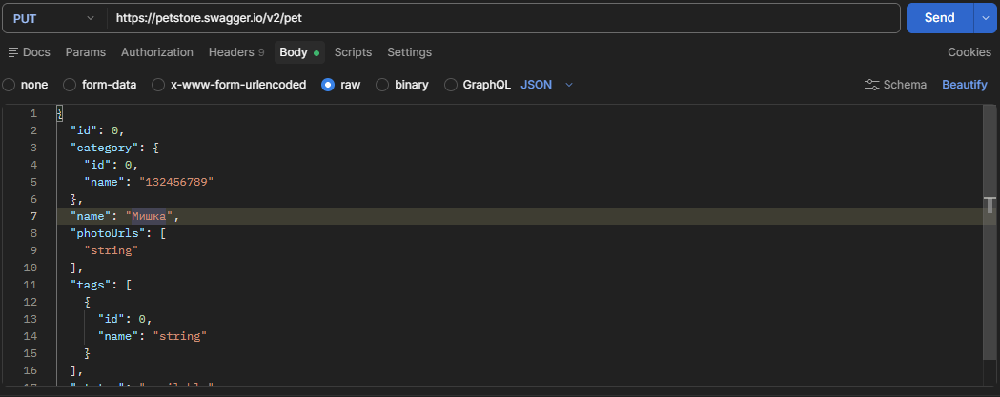
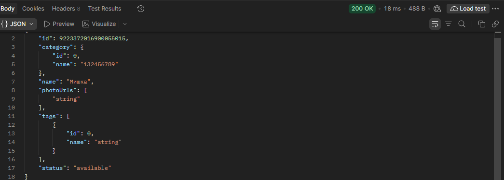
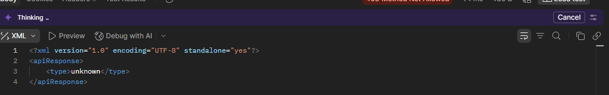
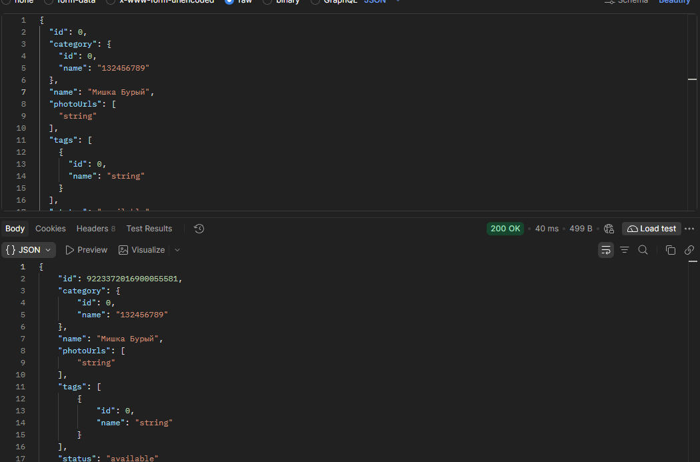
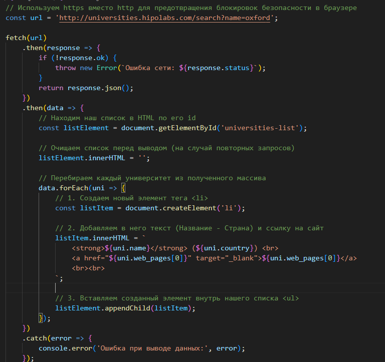

# Конспект: практическая 7 — работа с API

## Задание 1. Postman: добавить животное и получить его

Через Postman отправлен запрос на добавление животного, затем запрос на его получение.

## Задание 1.2. Удаление животного (DELETE)

Отправлен запрос `DELETE`, затем выполнена проверка, что животное удалено.

## Задание 1.3. Обновление животного (PUT)

Информация о животном обновлена запросом `PUT`.

## Задание 2. Общедоступное API

Найдено общедоступное API, данные с него выведены на страницу.

## Кратко по методам

| Метод | Назначение |
|-------|-----------|
| POST | создать запись |
| GET | получить запись |
| PUT | обновить запись |
| DELETE | удалить запись |
